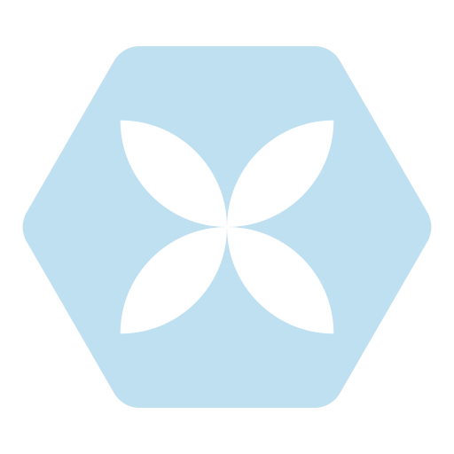

<p align="center"></p>

<h1 align="center">Halo</h1>

<p align="center">
  <a href="https://github.com/joezhuo2/halo/releases/latest"></a>
  <a href="https://github.com/joezhuo2/halo/releases"></a>
  <a href="https://github.com/joezhuo2/halo/actions/workflows/release.yml"></a>
  
  <a href="https://www.rust-lang.org"></a>
  <a href="https://www.egui.rs"></a>
  <a href="LICENSE"></a>
</p>

<p align="center">
  <a href="#download">Download</a> •
  <a href="#features">Features</a> •
  <a href="#settings-and-keybinds">Keybinds</a> •
  <a href="#screenshots">Screenshots</a> •
  <a href="#files">Files</a> •
  <a href="#development">Development</a> •
  <a href="#contributing">Contributing</a> •
  <a href="#license">License</a>
</p>

> Halo is an ultra-lightweight native code editor laid out like VS Code. It is
> written in Rust with egui on OpenGL, with no Electron and no web view, and
> ships as one executable. It has an explorer, a multi-cursor editor with split
> views and language server support, an integrated terminal, source control
> with a commit graph and pull requests, a panel that runs the Claude and
> Codex CLIs, and a settings page for fonts, colors, languages and key
> bindings.

<p align="center"><b>Opens in 570 ms, idles at 125.6 MB</b> (folder with two files restored, Windows 11; see <a href="#performance">Performance</a>)</p>

<p align="center"></p>

## Download

Get the latest build from
[Releases](https://github.com/joezhuo2/halo/releases/latest):

- **Windows installer:** `halo-x.y.z-windows-x64-setup.exe`. Installs per
  user, no admin prompt. Adds a Start menu entry and **Open with Halo** on
  files, folders and folder backgrounds, and lists Halo in **Open with** and
  under Settings > Apps > Default apps for common text and code files.
- **Windows portable:** `halo-x.y.z-windows-x64.exe`. One file, no install.
- **Linux x64:** `halo-x.y.z-linux-x64.tar.gz`.
- **macOS:** `halo-x.y.z-macos-arm64.tar.gz` (Apple silicon) or
  `halo-x.y.z-macos-x64.tar.gz` (Intel).

### First launch

Halo is not code-signed, so the system warns the first time you open it. The
builds come from the public [release workflow](.github/workflows/release.yml),
so you can check what went into them.

- **Windows:** SmartScreen says "Windows protected your PC". Click
  **More info**, then **Run anyway**. You only see this once.
- **macOS:** the download is quarantined. Unpack it, run this, then start it:

  ```bash
  xattr -d com.apple.quarantine ./halo
  ```

- **Linux:** unpack and run `./halo`. It needs OpenGL and either X11 or
  Wayland.

Halo needs `git` on `PATH` for source control, the `gh`, `claude` and `codex`
CLIs for pull requests and the AI panel, and a language server for each
language you want diagnostics and completion in. Each is optional.

## Features

### Editor

- **Multi-cursor editing:** `Ctrl+D` adds the next occurrence and
  `Ctrl+K Ctrl+D` skips the last one added for the next, `Ctrl+Alt+Up`
  and `Ctrl+Alt+Down` add cursors above and below, and `Shift+Alt+I` puts a
  cursor at the end of every selected line.
- **Selections:** `Alt+Click` adds a cursor, `Shift+Alt+drag` and
  `Ctrl+Shift+Alt+Arrow` select a box (plain drags do too in Toggle Column
  Selection Mode),
  `Ctrl+Shift+L` selects every occurrence, `Shift+Alt+Right` and
  `Shift+Alt+Left` grow and shrink the selection (by the language server's
  selection ranges when it has them), and `Ctrl+U` undoes the last cursor
  move.
- **Subword navigation:** Cursor Word Part Left and Right (and their Select
  forms) stop at camelCase humps, acronyms, underscores, hyphens and digits;
  `Ctrl+Alt+Backspace` and `Ctrl+Alt+Delete` delete a word part.
- **Find and replace** in the file (`Ctrl+F`, `Ctrl+H`) with match case,
  whole word, regular expressions (`$1` in the replacement), find in
  selection and preserve case. `Up` and `Down` in the find box recall earlier
  searches. **Go to Line** is `Ctrl+G`.
- **Search in files** (`Ctrl+Shift+F`) in the side bar: replace in files,
  include and exclude globs and a results tree.
- **Search editor:** New Search Editor, or Open Results in Editor
  (`Alt+Enter` in the search panel), shows the results as an editable tab.
  Edit the query, flags or globs in its header and press `Enter` or
  `Ctrl+Shift+R` to search again; `Alt+C`, `Alt+W`, `Alt+R` and `Alt+L`
  toggle match case, whole word, regex and context lines. Double-click,
  `F12` or `Ctrl+Click` opens a result. It saves and opens as VS Code
  `.code-search` files.
- **Line operations:** move (`Alt+Up`, `Alt+Down`), copy (`Shift+Alt+Up`,
  `Shift+Alt+Down`), delete (`Ctrl+Shift+K`), join, and insert a line above
  (`Ctrl+Shift+Enter`) or below (`Ctrl+Enter`). Comments toggle with `Ctrl+/`
  (line) and `Shift+Alt+A` (block).
- **Brackets and quotes** close as you type and wrap a selection. Brackets
  are colored by depth, with indentation guides. `Ctrl+Shift+\` jumps to the
  matching bracket, and Select to Bracket selects the brackets and what is
  between them.
- **Code folding** from the language server's folding ranges, by
  indentation, and between `#region` / `#endregion` markers (the gutter
  arrows, `Ctrl+Shift+[` and `Ctrl+Shift+]`). `Ctrl+K Ctrl+1` to
  `Ctrl+K Ctrl+7` fold a level, `Ctrl+K Ctrl+[` and `Ctrl+K Ctrl+]` fold and
  unfold recursively, and `Ctrl+K Ctrl+/` folds all block comments.
- **Word wrap** (`Alt+Z`), **sticky scroll**, rulers and visible whitespace.
  Each has a switch in Settings.
- **Linked editing:** renaming an HTML, XML, SVG, Vue, Svelte, JSX or TSX tag
  renames its closing tag, with or without a language server.
- **Color decorators:** a swatch before each hex, `rgb()` and `hsl()` value
  (or the colors the language server reports); click it, or run Show Color
  Picker, to pick a color in the value's own format.
- **Unicode highlighting:** invisible characters and characters that look
  like ASCII ones (a Cyrillic `а` in a name) get a box and a tooltip.
- **Fonts:** font ligatures (`editor.fontLigatures`, with a font such as
  Cascadia Code or Fira Code), letter spacing, and a smooth caret animation.
- **Copy with syntax highlighting:** on Windows, copied code pastes into
  Word, Outlook or OneNote with its colors.
- **Snippets** with tab stops from `snippets.json` and from language servers,
  **word completion** in files without a server, and **Emmet**: `Tab` expands
  an abbreviation such as `ul>li*3` in HTML, Vue, Svelte and PHP files.
- **Status bar pickers** for the language, indentation (detect and convert),
  encoding and line ending of the file.
- **Links** and paths to existing files in the text open with `Ctrl+Click`;
  holding `Ctrl` underlines what a click would follow.
- **Syntax highlighting** for 68 languages from the bundled grammars, plus
  any `.sublime-syntax` file you add. A minimap sits beside the text.
- **Tabs:** drag a tab to reorder it, drop it on another group to move it, or
  drop it on the left or right third of an editor to open it side by side.
  The tab follows the pointer and the others slide apart to show where it
  lands. Right-click a tab to pin it; pinned tabs stay on the left, are
  skipped by Close Others, Close All and `Ctrl+W`, and come back after a
  restart. A newly opened file is a preview with
  an italic title, and the next file you open takes its tab until you edit it
  or double-click the tab. With the Wrap Tabs setting
  (`workbench.editor.wrapTabs`) on, tabs that do not fit wrap onto more
  rows instead of scrolling. `Ctrl+Tab` switches between recent files,
  `Ctrl+Shift+T` reopens a closed one, `Alt+Left` and `Alt+Right` go back
  and forward, and `Ctrl+K Ctrl+Q` returns to the last edit.
- **Split editor** right (`Ctrl+\`), down (`Ctrl+K Ctrl+\`), left or up, or
  pick a layout such as Two Rows or Grid (2x2). Drag the lines between groups
  to resize them, maximize a group with `Ctrl+K Ctrl+M`, and move between
  groups with `Ctrl+K Ctrl+Arrow`. Dropping a tab on any edge of a group
  splits that way; dropping it outside the window opens it in its own
  window. `Ctrl+Shift+N` opens a new Halo window. Lock a group (View:
  Toggle Editor Group Lock, or Lock Group on a tab's menu) and files you
  open go to another group; a lock button on the group unlocks it.
- **Merge conflicts** get a bar with Accept Current, Accept Incoming, Accept
  Both and Next, and open in the **merge editor**: Incoming, Current, an
  optional Base and an editable Result, with accept per conflict and Complete
  Merge, which saves and stages the file.
- **Diff editor:** changes open side by side, and the working tree side is
  the live file, so you can edit it there. `Alt+F5` and `Shift+Alt+F5` step
  through changes. Stage, unstage or revert a single hunk or the selected
  lines. Click a change mark in the gutter to peek at the change. `F7` and
  `Shift+F7` open the **accessible diff viewer**, which lists one change at
  a time, line by line, for screen readers.
- **Compare** the active file with another file, the clipboard or its saved
  version. **Compare Folders...** diffs two directories and lists the
  changed and one-sided files; pick one to open its diff.
- **Bookmarks:** `Ctrl+Alt+K` toggles a bookmark on the line (shown in the
  gutter), `Ctrl+Alt+L` and `Ctrl+Alt+J` jump to the next and previous one
  across files, Bookmarks: Label names one and Bookmarks: List picks one.
  They follow edits and come back with the folder.
- **Jump to a visible word** (`Alt+J`): every word on screen gets a
  two-letter label; type it to move the cursor there, `Esc` cancels.
- **Clipboard history** (`Ctrl+K Ctrl+V`): pick one of the last 20 things
  copied or cut in an editor to paste it.
- **Macros:** `Ctrl+K Ctrl+R` starts and stops recording keystrokes and
  commands (the status bar shows it), `Ctrl+K Ctrl+P` plays them back.
- **TODO list:** Search: Find TODO and FIXME Comments lists every TODO,
  FIXME, HACK, XXX and BUG in the workspace in the Search view, grouped by
  file.
- **Window color:** Window: Set Color... tints the title bar for the open
  folder (saved in its `.vscode/settings.json` as `peacock.color`, so
  colors set with the Peacock extension carry over).
- **Editor group zoom:** `Ctrl+K Ctrl+=` and `Ctrl+K Ctrl+-` make the text of
  the active editor group larger or smaller without zooming the window;
  View: Reset Editor Group Zoom goes back.
- **Named layouts:** Layouts: Save Open Editors As... keeps the open tabs
  and splits under a name, Layouts: Switch... brings them back and
  Layouts: Delete... forgets one. They are saved per folder; files with
  unsaved changes stay open when you switch.
- **Scratch files:** Scratch: New Scratch File... opens a new file in the
  language you pick, kept per folder in Halo's settings folder so it never
  shows up in git; Scratch: Open Scratch File... lists them, newest first.
- **Vertical tabs:** the tree button on Open Editors (or View: Toggle Open
  Editors Tree) groups the open files by folder, and Show Tabs: Hide in
  Settings removes the tab strip so that list is your tabs.
- **Run configurations in a form:** Debug: Edit Configuration in a Form...
  (also the pencil in Run and Debug) and Tasks: Edit Task in a Form... add
  or change a `launch.json` configuration or `tasks.json` task through
  fields instead of JSON. Other properties are kept; comments in the file
  are not.
- **Markdown preview** (`Ctrl+Shift+V`, or `Ctrl+K V` to the side) follows
  the source as you type and scroll. Tables size their columns to the
  content and code blocks have a copy button.
- **Markdown editing:** completions for paths and heading anchors inside
  links, warnings for links to missing files and headings
  (`markdown.validate.enabled`), `Ctrl+V` with an image on the clipboard
  saves it as `image.png` next to the file and links it (Windows), and
  `Shift`+drop of files inserts links to them.
- **Vim mode** (off by default; Toggle Vim Mode, or Settings > Text Editor):
  normal, insert, visual and visual line modes with counts, the motions
  `hjkl w b e W B E 0 ^ $ gg G f t F T ; , { } % n N * #`, the operators
  `d c y > <` (doubled for whole lines), `x X D C s S Y p P r J ~ u .`,
  `/` and `?` search, and `:w`, `:q`, `:wq`, `:wa` and `:<line>`. The status
  bar shows the mode. Yanks also go to the clipboard; redo stays on
  `Ctrl+Y` because `Ctrl+R` opens recent files.
- **Images** (png, jpg, gif, webp, bmp, ico, svg) open in a viewer with zoom
  and pan. Binary files show a notice instead of text, and files over 20 MB
  open in a light mode without highlighting or language servers.
- **Log viewer:** files over 256 MB open in a viewer that streams them from
  disk instead of loading them, so multi-GB logs open at once. It indexes
  lines in the background, searches the whole file (smart case, Enter and
  Shift+Enter step through the matches), and **Follow** keeps the end in
  view as the file grows; a truncated or rotated file is read again. View:
  Open Active File in Log Viewer (or Log Viewer on the light mode bar)
  opens a smaller saved file the same way.
- **Hex editor:** binary files offer Open in Hex Editor, and View: Reopen
  Active File in Hex Editor opens any saved file as bytes (up to 256 MB).
  Type hex digits to overwrite bytes, or click the text column (or press
  `Tab`) to type characters; edited bytes are colored, `Ctrl+Z` undoes and
  `Ctrl+S` writes the file.
- **CSV table view:** CSV: Toggle Table View shows a `.csv`, `.tsv` or other
  delimited file as a table with a fixed header row (the delimiter is
  detected from the first line, and quoted fields may hold delimiters and
  line breaks). Click a column header to sort, numbers by value.
- **Auto save** (off by default): after a delay, on focus change or on window
  change. Saving can trim trailing whitespace and add a final newline.
- **Hot exit:** unsaved and untitled files come back the next time Halo
  opens. When a file you changed also changes on disk, a bar offers Compare,
  Use Disk Version and Overwrite.
- **Auto update** (on by default): when Halo opens it looks for a newer
  release, checks its SHA-256, installs it in the background and uses it the
  next time Halo opens. It needs `curl` on `PATH`.

### Language servers

Halo starts the language server of a file when you open it, if that server is
on `PATH`. Nothing is bundled and nothing is downloaded. The defaults cover
`rust-analyzer`, `pyright-langserver`, `typescript-language-server`, `gopls`,
`clangd`, `csharp-ls`, `jdtls`, `lua-language-server`, `zls` and the VS Code
JSON, HTML and CSS servers; **Settings > Languages** sets the command for each
file extension.

- **Diagnostics:** errors and warnings are underlined in the text and marked
  in the minimap, listed in the **Problems** panel (`Ctrl+Shift+M`) and
  counted in the status bar. Click a problem to go to it. The panel filters
  by text, by severity and to the active file.
- **Completion** as you type or with `Ctrl+Space`, **signature help** inside
  a call, and **hover** when the pointer rests on a name.
- **Go to Definition** (`F12` or `Ctrl+Click`), declaration, type definition
  and implementations, **Peek Definition** (`Alt+F12`) and **Find All
  References** (`Shift+F12`). Several results open a peek list with a preview
  of each place, between the lines of the file. `Alt+Left` goes back.
- **Symbol highlights:** when the caret rests on a name, the other places
  that use it in the file are highlighted.
- **Code lenses:** reference counts sit on a line above each function,
  method and type, next to the server's own lenses such as rust-analyzer's
  Run and Debug. Click a count to peek at the places, Run to run in the
  terminal, or Debug to debug a single test.
- **Rename Symbol** (`F2`) across files, **Quick Fix** and refactorings
  (`Ctrl+.`, or the lightbulb in the gutter when the line has some), and
  **Organize Imports** (`Shift+Alt+O`).
- **Format Document** (`Shift+Alt+F`) and **Format Selection**
  (`Ctrl+K Ctrl+F`), with optional format on save, on paste and on type.
- **Symbols:** `Ctrl+T` searches the workspace, the **Outline** section under
  the explorer lists the active file (it follows the caret and sorts by
  position, name or kind), and the breadcrumbs above the text show
  the path and the enclosing symbols.
- **Timeline:** the section under the outline lists the commits that changed
  the active file and the versions kept each time you saved it (**local
  history**). Click one to open its diff; a saved version can be restored.
  The file history follows renames. **Git: Show History of Selected Lines**
  narrows it to the commits that changed the selected lines (`git log -L`),
  so you can see who changed a block and when, even after it moved.
- **Semantic highlighting**, **inlay hints** for inferred types and parameter
  names, and **call** (`Shift+Alt+H`) and **type hierarchy** in the peek list.
- Server messages go to the **Output** panel, and the status bar shows what
  the servers are doing. **Restart Language Servers** is in the command list.

Each of these can be switched off under **Settings > Text Editor**.

### Explorer

- Files and folders are colored by git state: green for new, yellow for
  modified, red for deleted, gray for ignored. A file with errors is red and
  one with only warnings is yellow, in the tree, in Open Editors and on its
  tab; folders that contain it are tinted too.
- New file, new folder, rename, delete to the Recycle Bin, copy path and
  reveal in the file manager, from the right-click menu. Where there is no
  Recycle Bin (WSL folders), Halo asks before deleting permanently.
- The Open Editors, folder, Outline and Timeline sections are resized by
  dragging the line between them; double-click the line to reset.
- Select several files (`Ctrl+Click`, `Shift+Click`), cut, copy and paste
  them, drag them to another folder, and drop files in from the operating
  system.
- **Open Editors** lists the open tabs above the tree. Type, or press
  `Ctrl+Alt+F`, to filter the tree. `files_exclude` hides files, and folder
  chains with a single child are shown on one row.
- **File nesting** (off by default) tucks related files under a parent, such
  as `Cargo.lock` under `Cargo.toml`, with VS Code's pattern syntax.
- **Multi-root workspaces:** File > Add Folder to Workspace puts several
  folders in one window, each as a root in the tree. Save the set as a
  `.code-workspace` file. Search, source control, tasks, debugging and
  language servers cover every folder, and each folder can have its own
  `.vscode/settings.json`.

### Source control

- Stage, unstage and discard changes, write a message and commit with
  `Ctrl+Enter`. Amend, or undo the last commit.
- Switch or create branches, push, pull, fetch, and synchronize from the
  status bar. Merge, rebase and cherry-pick, with Continue, Abort and Skip
  while one is in progress. **Interactive rebase** to reorder, reword,
  squash, fixup, edit or drop commits.
- **Compare** any two branches, tags or commits and open each changed file's
  diff.
- **Generate a commit message** from your changes with the Claude or Codex
  CLI.
- Tags, remotes, worktrees, Clone and Initialize Repository, and a Stashes
  section with Show, Apply, Pop and Drop.
- **Blame** for the current line in the status bar, and inline on the caret
  line if you turn it on. Hover it for the full commit message and a link to
  the commit on GitHub, GitLab or Bitbucket.
- The stashes, changes, pull requests and commits sections can be minimized,
  and resized by dragging the line between them. Commits load 10 at a time
  as you scroll.
- **Commit graph** with lanes and branch labels. Click a commit to list its
  files, and a file to open its diff. Incoming and outgoing commits are shown
  before you pull or push.
- **Pull requests** through the `gh` CLI: list, create, check out, approve,
  request changes and comment. Review in Diff shows review threads on their
  lines, where you can comment, reply and resolve.
- **Accounts:** list and switch the GitHub accounts `gh` is signed in to.
- Repositories nested inside the open folder are listed and can be selected.

### Terminal

- Runs PowerShell, Command Prompt, Git Bash, WSL or any shell you add as a
  profile.
- Several terminals, each of which can be split side by side. Every pane has
  its own row in the list, and the focused one is highlighted.
- `Ctrl+Click` opens a URL or a file path, at the line and column when the
  output names them. `Ctrl+F` finds in the terminal.
- **Shell integration** for PowerShell, bash and zsh marks each command with
  its exit status; `Ctrl+Up` and `Ctrl+Down` move between commands.
- **Suggestions** as you type: commands from PATH and history, subcommands
  and flags of common tools (git, cargo, npm, docker and more), and folders
  and files. `Tab` accepts, `Down` picks another, `Ctrl+Space` opens the
  list.
- **Quick fixes** on a finished command: a lightbulb (or `Ctrl+.`) offers
  `git push --set-upstream`, the command git meant for a typo, the pull
  request page after a push, or stopping the process that holds a busy port.
- **Sticky scroll** keeps the command whose output fills the terminal pinned
  to the top row; click it to scroll back to the command.
- **Images** printed as Sixel or iTerm inline images are shown in place on
  Linux and macOS.
- Rename a terminal, give it a colour, or move it into the editor area.
- Terminals come back after a restart in the same places, with their name,
  folder and the last 1000 lines of history.
- **Ports** lists listening ports with their process. **Output**
  (`Ctrl+Shift+U`) has a channel each for Git, language servers, debugging,
  tasks and Halo itself.

### AI panel

- `Ctrl+Alt+B`, or the robot button beside Split Editor, opens a panel with a
  **Claude**, **Codex**, **Gemini** and **OpenCode** tab. Each runs that CLI
  in the open folder when you press **Start session**. Nothing starts until
  you ask.
- If a CLI is missing, the tab offers **Install <name> CLI**, which runs the
  official installer (Claude's install script, or `npm install -g` for the
  others) in the panel's terminal.
- **Inline suggestions**: `Alt+\` asks the CLI for a completion at the
  cursor and shows it as dimmed ghost text, with further lines below the
  cursor line. `Tab` accepts it, `Ctrl+Right` accepts the next word, `Esc`
  dismisses it, and typing what it shows keeps the rest. Turn on **Inline
  Suggestions** in Settings to ask after each pause in typing.
- **Next edit suggestions**: `Alt+]` asks for the next likely edit in the file
  from your recent edits. The lines to change are struck through and the new
  lines shown below them, with an arrow in the gutter; `Tab` jumps there and
  `Tab` again applies it. **Next Edit Suggestions** in Settings asks after
  each edit. Both settings are off by default because every request uses the
  CLI's quota.
- **Agent Changes**: when a session starts in a Git folder, Halo notes every
  file's content (untracked files too, without touching your index or
  stashes). Files the agent then adds, edits or deletes are listed at the top
  of the panel with A/M/D badges and line counts. Click one to open its diff,
  and **Keep** or **Undo** it per file or all at once (Undo asks first and
  sends created files to the recycle bin). The palette has **Agent Changes:
  Keep All**, **Undo All**, **Show** and **Reset Baseline**.
- **Inline chat** (`Ctrl+I`, also in the editor's right-click menu) opens a
  prompt above the selected lines, or the cursor line. Describe the change and
  press `Enter`; the Claude or Codex CLI answers and the change shows in place,
  removed lines in red and new lines in green. `Ctrl+Enter` accepts it as one
  undo step, `Escape` discards it, and another prompt refines it. `Up` and
  `Down` recall earlier prompts.

### Search

The bar in the title bar (`Ctrl+P`) finds files by name. A prefix changes
what it searches:

| Prefix | Searches |
| --- | --- |
| none | Files in the open folder |
| `>` | Commands |
| `%` | Text in files |
| `@` | Symbols in the current file |
| `#` | Symbols in the workspace, from the language servers |
| `:` | A line number |

### Run, debug and test

- `F5` saves the file and runs it with the command set for its extension.
  With a `.vscode/launch.json` in the folder, `F5` starts the debugger
  instead and `Ctrl+F5` runs without it.
- **Debugger** for any Debug Adapter Protocol adapter on `PATH` (defaults for
  codelldb, lldb-dap, gdb, debugpy and dlv; set others in `debug_adapters`):
  breakpoints with conditions, hit counts and logpoints (`F9`), stepping
  (`F10`, `F11`, `Shift+F11`), variables, watch, call stack, and a Debug
  Console that evaluates expressions while paused. Also inline values, Run
  and Jump to Cursor, function and data breakpoints, disassembly and memory
  views, several sessions at once with compound configurations, and a
  process picker for `${command:pickProcess}`.
- **Tasks** from `.vscode/tasks.json`, plus npm, yarn, pnpm, bun and cargo
  tasks found in the folder. `Ctrl+Shift+B` runs the build task. Problem
  matchers send compiler errors to the Problems panel.
- **Testing** view for cargo, pytest, go, Jest and Vitest: run all, run
  failed, run or debug the test at the cursor, and run with coverage.

### WSL

- **Switch to WSL** in the activity bar reopens the folder in a WSL distro.
  Terminals, Run, language servers and the AI panel then run inside it, so a
  server such as `clangd` must be installed in the distro.

### Window layout

- **Zen mode** (`Ctrl+K Z`, `Esc Esc` to leave), **full screen** (`F11`) and
  a centered editor.
- The side bar can sit on the left or right, the panel on any side, and the
  activity bar at the side, at the top of the side bar, or hidden.
- A **secondary side bar** (`Ctrl+Alt+B`) holds the AI view. "View: Move
  View..." or a drag moves the Explorer, Source Control, Testing, Outline,
  Timeline, Terminal and the other views between the side bars and the
  panel.
- **Open Recent** (`Ctrl+R`, or File > Open Recent) lists the recent folders
  and files to open again.
- **Windows:** right-click the taskbar icon for recent folders, recent files
  and New Window. Pin an item to keep it in the list.
- **macOS:** the native traffic lights sit in the title bar, and the green
  button opens a fullscreen Space.

### Accessibility

- Screen readers get names, roles and states for the trees, lists, tabs and
  buttons, and the caret line of the editor and terminal as text.
- **High Contrast Dark** and **High Contrast Light** themes, which follow
  Windows high contrast mode.
- **Audio cues** (Windows): short sounds when the cursor reaches a line with
  an error, warning, breakpoint or fold, and for inserted and removed lines
  in the accessible diff viewer. They play while a screen reader is in use,
  or always with the `accessibility.signals.*.sound` settings set to on.
- **Reduce motion** stops animations. `F6` and `Shift+F6` move between the
  editor, side bar, panel and status bar, and `Alt+F1` lists the keys for
  the part that has focus.

### Command line

```
halo [options] [paths...]
```

- `halo file.rs:12:3` opens a file at a line and column, and
  `halo --diff a b` compares two files.
- A second `halo` hands its files to the window that is already open;
  `--new-window` opens another one.
- `halo --wait file` returns when the file's tab is closed, so
  `git config core.editor "halo --wait"` works.
- `halo --help` lists every option. The Windows installer puts `halo` on
  `PATH`; on macOS and Linux run "Shell Command: Install 'halo' command in
  PATH".

### Settings and keybinds

`Ctrl+,` opens Settings, with categories on the left:

| Category | What it sets |
| --- | --- |
| Text Editor | Font family, font size, tab size, spaces or tabs, minimap, breadcrumbs, code lens, inlay hints, semantic highlighting, format on save and paste, diagnostics and the status bar counts |
| Files | Auto save |
| Appearance | Dark or light theme, and every interface and syntax color for each theme |
| Terminal | Default profile and the list of profiles |
| Run and Tasks | The run command for each file extension, and named tasks |
| Languages | Grammars folder, file associations, language servers and their commands, and the installed languages |
| Keyboard Shortcuts | Every command with its key, grouped by category |

A search box at the top filters the settings; `@modified` lists the ones you
changed. Settings can also live in the folder's `.vscode/settings.json`
(the Workspace tab) and in `"[language]"` blocks, and both files accept VS
Code's setting names. VS Code color themes and file icon themes can be
imported from a file or from installed VS Code extensions.

To change a key, click it in **Keyboard Shortcuts** and press the new one or
a two-step chord; the page lists the commands already on those keys. Each
binding can have a `when` clause, as in VS Code's `keybindings.json`.

The defaults follow VS Code:

| Key | Action |
| --- | --- |
| `Ctrl+P` | Go to file |
| `Ctrl+Shift+P` | Show all commands |
| `Ctrl+Shift+F` | Find in files |
| `Ctrl+Shift+O` | Go to symbol |
| `Ctrl+T` | Go to symbol in workspace |
| `F12` | Go to definition |
| `Shift+F12` | Find all references |
| `F2` | Rename symbol |
| `Ctrl+I` | Inline chat |
| `Ctrl+.` | Quick fix |
| `Shift+Alt+F` | Format document |
| `Ctrl+Space` | Trigger suggest |
| `Alt+\` | Trigger inline suggestion (AI) |
| `Alt+]` | Suggest next edit (AI) |
| `Ctrl+Shift+M` | Problems |
| `Ctrl+B` | Toggle side bar |
| `Ctrl+J` | Toggle panel |
| `Ctrl+Alt+B` | Toggle secondary side bar (AI) |
| `Ctrl+\` | Split editor |
| `` Ctrl+Shift+` `` | New terminal |
| `Ctrl+K Ctrl+O` | Open folder |
| `Ctrl+R` | Open a recent folder or file |
| `Ctrl+K Ctrl+T` | Switch light and dark theme |
| `F5` | Run file, or start debugging |
| `Ctrl+Shift+B` | Run build task |
| `F11` | Full screen |

The sun or moon at the right end of the status bar also switches the theme.

### Limits

- Language features need a server that is installed and on `PATH` (inside
  the distro for WSL folders).
- Debug lenses work for single cargo tests; other runnables fall back to
  Run.
- The Markdown preview does not render HTML tags.
- Copy with syntax highlighting, pasting images and audio cues are Windows
  only.
- Call and type hierarchy list one level at a time.
- New grammars and file associations load when Halo starts.
- Debugging and testing need the adapter or test tool on `PATH`. Other
  `${command:...}` variables than the process picker are not supported.
- Imported icon themes must use SVG or PNG icons, and imported color themes
  must be JSON.
- No VS Code extensions.
- Restored terminals show their old output and start a fresh shell; the
  programs that were running in them are not kept alive.
- Terminal images do not appear on Windows: the Windows pseudo console drops
  Sixel and iTerm image sequences before they reach Halo.
- High contrast and reduced motion follow the operating system on Windows
  only.

## Screenshots

Click an image to view it at full size.

| | |
| :---: | :---: |
| [](assets/screenshot-editor.png)<br>**Editor** with the explorer and an integrated terminal. | [](assets/screenshot-source-control.png)<br>**Source control** with pull requests and the commit graph. |
| [](assets/screenshot-settings.png)<br>**Settings** lets you change every color of a theme. | [](assets/screenshot-light.png)<br>**Light theme**, one click from the status bar. |

## Files

| What | Windows | Linux | macOS |
| --- | --- | --- | --- |
| Settings | `%APPDATA%\halo\settings.json` | `~/.config/halo/` | `~/Library/Application Support/halo/` |
| Key bindings | `%APPDATA%\halo\keybindings.json` | `~/.config/halo/` | `~/Library/Application Support/halo/` |
| Open folder, files and panels | `%APPDATA%\halo\session.json` | `~/.config/halo/` | `~/Library/Application Support/halo/` |
| Extra grammars | `%APPDATA%\halo\grammars\` | `~/.config/halo/grammars/` | `~/Library/Application Support/halo/grammars/` |

Everything on the Settings page is stored in `settings.json`, and the button
at the top right of the page opens the file. Saving it in Halo applies it.
Each entry in `keybindings.json` is
`{"key": "ctrl+k ctrl+o", "command": "openFolder"}`; it replaces the default
keys of that command, and an empty `key` removes them.

## Development

### Build

Requirements: Rust 1.85 or newer, and `git` on `PATH`.

```bash
cargo run --release
```

To build the Windows installer locally, install Inno Setup 6.3 or newer and
run this after `cargo build --release`. The result lands in `dist`.

```bash
ISCC /DAppVersion=x.y.z installer\halo.iss
```

### Releasing

Releases are built by GitHub Actions. Set `version` in `Cargo.toml`, add a
`## [x.y.z] - date` section to `CHANGELOG.md` listing the changes, commit
and push to `main`, then run `gh workflow run release.yml --ref main -f
release=true`. [release.yml](.github/workflows/release.yml) builds every
platform and, only if every build passes, creates a draft GitHub release for
`vx.y.z` with the files attached and that changelog section as its notes.
Review the draft and publish it; publishing creates the tag. Run it without
`release=true` to build without releasing. The run fails if the tag already
exists or `CHANGELOG.md` has no section for the version.

### Tests

```bash
cargo test
```

35 tests: the edit engine, highlighting, git parsing against a real temporary
repository, explorer logic on a temporary folder, tab moves and pins, key
bindings, terminal key encoding and colors, a real shell round trip through
the PTY, theme colors, the logo, language server messages and result parsing,
and headless editor tests that type and click through egui input, including
through code lens rows and inlay hints. `cargo test -- --ignored` adds a round
trip with a real `rust-analyzer`.

### Layout

```
src/
  main.rs           window setup and test mode
  app.rs            the Halo app: panels, command dispatch, dialogs, auto save
  command.rs        commands, default keys and keybindings.json
  titlebar.rs       menus, search box and window buttons
  statusbar.rs      problems, branch, sync, position and theme switch
  explorer.rs       file tree with git colors and file operations
  editor/           buffer and edits, highlighting, tabs, groups, the view and
                    the language features drawn in it
  lsp.rs            language server processes, messages and result parsing
  search.rs         file, command, text, symbol and line search
  git.rs            git and gh calls, status, log and graph lanes
  scm.rs            source control side bar
  accounts.rs       GitHub accounts menu
  terminal.rs       terminal emulator, bottom panel and ports
  ai.rs             Claude and Codex CLI panel
  wsl.rs            WSL distros and path mapping
  settings.rs       settings.json and session.json
  settings_page.rs  the Settings page
  theme.rs          dark and light themes, custom colors and fonts
  ui.rs             shared widgets, animation helpers and the logo
installer/halo.iss  Inno Setup script
assets/             icon, screenshots and the demo
docs/               requirements, decisions, architecture, milestones, handoff,
                    and the startup measurement script
```

### Performance

The window and its chrome are drawn before the session is restored. The
explorer, the editor and the terminal show skeleton rows until the folder, the
open files and the terminals have loaded, which happens right after the window
appears; the folder check and the syntax definitions load on a background
thread. The session file is not written until the restore has finished.

Median of 5 runs per row, v0.1.8 against the v0.1.10 startup changes on top
of it, both run as `halo-ide.exe`:

| Session | Window on screen | Settled | Working set | Private bytes |
| --- | --- | --- | --- | --- |
| No folder: v0.1.8 | 458 ms | 983 ms | 107.8 MB | 131.9 MB |
| No folder: v0.1.10 | 426 ms | 956 ms | 108.0 MB | 132.5 MB |
| 5 folders, 25 tabs: v0.1.8 | 445 ms | 1252 ms | 138.0 MB | 122.0 MB |
| 5 folders, 25 tabs: v0.1.10 | 429 ms | 1048 ms | 134.8 MB | 117.6 MB |
| 20 folders, 50 tabs: v0.1.8 | 456 ms | 1654 ms | 160.8 MB | 145.2 MB |
| 20 folders, 50 tabs: v0.1.10 | 447 ms | 1166 ms | 140.8 MB | 124.8 MB |
| 20 folders, no tabs: v0.1.8 | 455 ms | 1380 ms | 109.9 MB | 113.4 MB |
| 20 folders, no tabs: v0.1.10 | 447 ms | 948 ms | 106.5 MB | 109.1 MB |

The large sessions use generated folders of about 5,000 files each, and tabs
of up to 8 MB. Run as `halo.exe`, the same v0.1.8 build took 3.8 s to show
the window and 260-300 MB private bytes, because the NVIDIA driver puts any
`halo.exe` on the discrete GPU through a game profile.

Median of 5 runs per row, v0.1.7 against v0.1.8:

| Session | Window on screen | Settled | Working set | Private bytes |
| --- | --- | --- | --- | --- |
| Folder, 2 files, terminal: v0.1.7 | 829 ms | 1355 ms | 127.0 MB | 128.4 MB |
| Folder, 2 files, terminal: v0.1.8 | 570 ms | 1149 ms | 125.6 MB | 125.7 MB |
| WSL folder, 2 files, terminal: v0.1.7 | 1011 ms | 1531 ms | 124.4 MB | 124.8 MB |
| WSL folder, 2 files, terminal: v0.1.8 | 569 ms | 1292 ms | 130.2 MB | 125.4 MB |
| No folder: v0.1.7 | 656 ms | 1177 ms | 106.7 MB | 132.0 MB |
| No folder: v0.1.8 | 577 ms | 1095 ms | 107.2 MB | 113.1 MB |

- **Window on screen:** from process start until the main window is visible
  and no longer cloaked (Halo keeps it cloaked until its first frames are
  drawn).
- **Settled:** the last moment at which Halo used more than half of one core
  over the previous 500 ms, so it includes up to 500 ms of tail after the
  work ends.
- **Memory:** working set and private bytes of `halo.exe` 10 s after start.
- With no folder there is nothing to restore, so that row moves only by
  noise, and private bytes land near 110 MB or near 130 MB from run to run
  in both builds.
- The first start after a new build is slower (1.5 to 1.9 s here) while
  Windows scans the new file; the median leaves it out.
- The features added in v0.1.8 cost no idle memory: a build with only the
  startup change measured 126.5, 130.1 and 107.0 MB working set for the
  three sessions.
- About 400 ms of every start is eframe creating the window and the OpenGL
  context, before any Halo code runs.

Machine: AMD Ryzen AI 9 HX 370 (12 cores), Radeon 890M (driver
32.0.21036.1002), 31.1 GB RAM, Windows 11 Home 10.0.26200, rustc 1.98.1,
`cargo build --release` (thin LTO, one codegen unit). Each run uses test mode
(`HALO_COMMANDS=none`, off screen, unfocused, default size). The folders are
small temporary git repositories with a `README.md`, `docs/notes.txt` and
`data.json`, one on the Windows drive and one under `/tmp` in Ubuntu 24.04 on
WSL 2 (already running); the session opens `docs/notes.txt` and `README.md`
with the panel showing a terminal. To repeat it, write a `session.json` for
your own test folder and run from the repository root:

```powershell
.\docs\measure-startup.ps1 -Exe target\release\halo-ide.exe -Session C:\path\to\test-session.json -Runs 5
```

The script backs up `%APPDATA%\halo\session.json`, copies the given session
over it before each run, and puts the original back at the end.

## Contributing

Bug reports and pull requests are welcome. [CONTRIBUTING.md](CONTRIBUTING.md)
says how to build, test and send a change, and the
[Code of Conduct](CODE_OF_CONDUCT.md) applies to everyone taking part. Report
security problems through [SECURITY.md](SECURITY.md).

## License

MIT.
