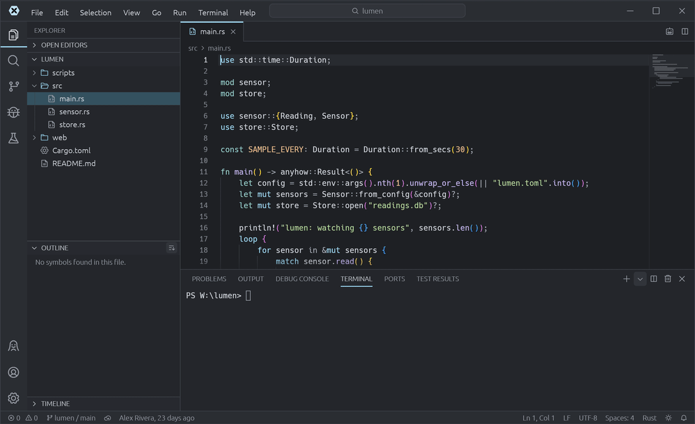
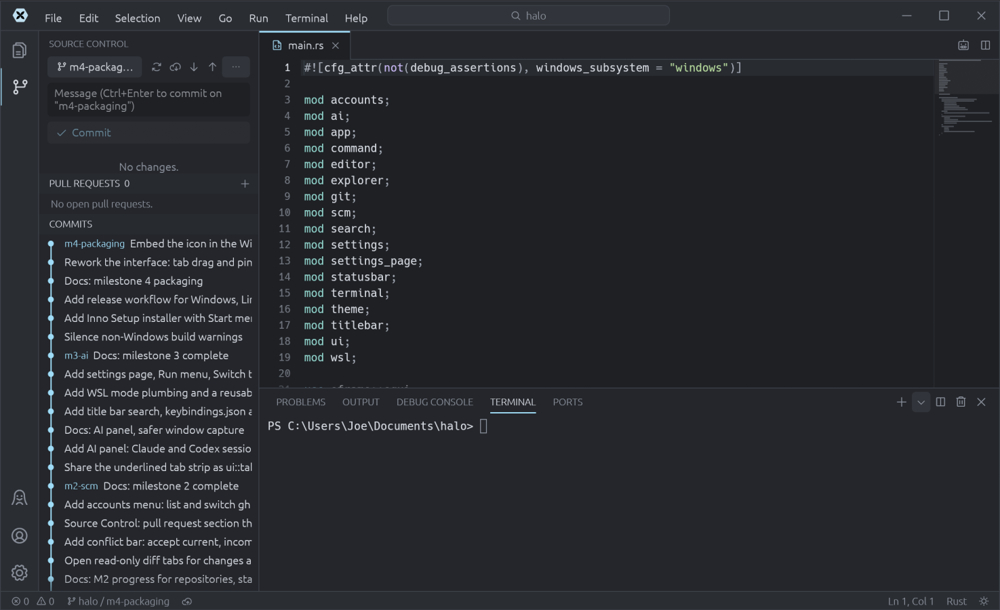
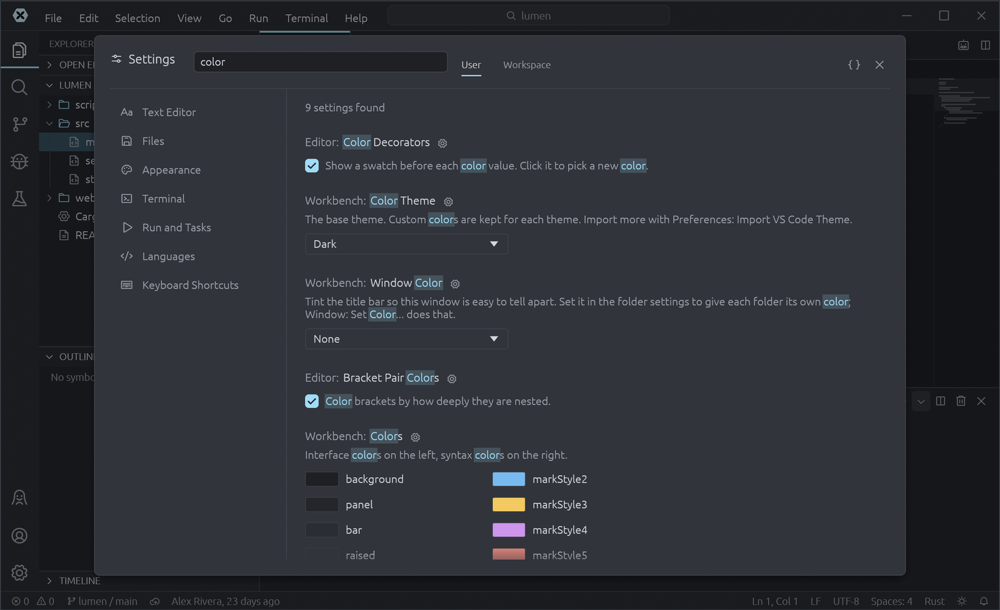

<p align="center"></p>

<h1 align="center">Halo</h1>

<p align="center">
  <a href="https://github.com/joezhuo2/halo/releases/latest"></a>
  <a href="https://github.com/joezhuo2/halo/releases"></a>
  <a href="https://github.com/joezhuo2/halo/actions/workflows/release.yml"></a>
  
  <a href="https://www.rust-lang.org"></a>
  <a href="https://www.egui.rs"></a>
  <a href="LICENSE"></a>
</p>

<p align="center">
  <a href="#download">Download</a> •
  <a href="#features">Features</a> •
  <a href="#settings-and-keybinds">Keybinds</a> •
  <a href="#screenshots">Screenshots</a> •
  <a href="#files">Files</a> •
  <a href="#development">Development</a> •
  <a href="#contributing">Contributing</a> •
  <a href="#license">License</a>
</p>

> Halo is an ultra-lightweight native code editor laid out like VS Code. It is
> written in Rust with egui on OpenGL, with no Electron and no web view, and
> ships as one executable. It has an explorer, a multi-cursor editor with split
> views, an integrated terminal, source control with a commit graph and pull
> requests, a panel that runs the Claude and Codex CLIs, and a settings page
> for fonts, colors, languages and key bindings.

<p align="center"></p>

## Download

Get the latest build from
[Releases](https://github.com/joezhuo2/halo/releases/latest):

- **Windows installer:** `halo-x.y.z-windows-x64-setup.exe`. Installs per
  user, no admin prompt. Adds a Start menu entry and **Open with Halo** on
  files, folders and folder backgrounds.
- **Windows portable:** `halo-x.y.z-windows-x64.exe`. One file, no install.
- **Linux x64:** `halo-x.y.z-linux-x64.tar.gz`.
- **macOS:** `halo-x.y.z-macos-arm64.tar.gz` (Apple silicon) or
  `halo-x.y.z-macos-x64.tar.gz` (Intel).

Windows 11 is the tested platform. The Linux and macOS builds compile and are
produced by the same workflow, but have not been run by hand yet.

### First launch

Halo is not code-signed, so the system warns the first time you open it. The
builds come from the public [release workflow](.github/workflows/release.yml),
so you can check what went into them.

- **Windows:** SmartScreen says "Windows protected your PC". Click
  **More info**, then **Run anyway**. You only see this once.
- **macOS:** the download is quarantined. Unpack it, run this, then start it:

  ```bash
  xattr -d com.apple.quarantine ./halo
  ```

- **Linux:** unpack and run `./halo`. It needs OpenGL and either X11 or
  Wayland.

Halo needs `git` on `PATH` for source control, and the `gh`, `claude` and
`codex` CLIs for pull requests and the AI panel. Each is optional.

## Features

### Editor

- **Multi-cursor editing:** `Ctrl+D` adds the next occurrence, `Ctrl+Alt+Up`
  and `Ctrl+Alt+Down` add cursors above and below.
- **Find and replace** in the file (`Ctrl+F`, `Ctrl+H`) with match case and
  whole word, **Go to Line** (`Ctrl+G`) and **Toggle Line Comment** (`Ctrl+/`).
- **Syntax highlighting** for 68 languages from the bundled grammars, plus
  any `.sublime-syntax` file you add. A minimap sits beside the text.
- **Tabs:** drag a tab to reorder it, drop it on another group to move it, or
  drop it on the left or right third of an editor to open it side by side.
  Right-click a tab to pin it; pinned tabs stay on the left and are skipped by
  Close Others, Close All and `Ctrl+W`.
- **Split editor** (`Ctrl+\`) shows one file in several groups.
- **Merge conflicts** get a bar with Accept Current, Accept Incoming, Accept
  Both and Next.
- **Auto save** (off by default) saves changed files one second after the
  last edit.

### Explorer

- Files and folders are colored by git state: green for new, yellow for
  modified, red for deleted, gray for ignored.
- New file, new folder, rename, delete to the Recycle Bin, copy path and
  reveal in the file manager, from the right-click menu.

### Source control

- Stage, unstage and discard changes, write a message and commit with
  `Ctrl+Enter`.
- Switch or create branches, push, pull, fetch, stash and pop, and
  synchronize from the status bar.
- **Commit graph** with lanes and branch labels. Click a commit to list its
  files, and a file to open its diff.
- **Pull requests** through the `gh` CLI: list, create, check out, approve,
  request changes and comment.
- **Accounts:** list and switch the GitHub accounts `gh` is signed in to.
- Repositories nested inside the open folder are listed and can be selected.

### Terminal

- Runs PowerShell, Command Prompt, Git Bash, WSL or any shell you add as a
  profile.
- Several terminals, each of which can be split side by side. Every pane has
  its own row in the list, and the focused one is highlighted.
- **Ports** lists listening ports with their process. **Debug Console**
  mirrors the output of Run File and tasks.

### AI panel

- `Ctrl+Alt+B`, or the robot button beside Split Editor, opens a panel with a
  **Claude** tab and a **Codex** tab. Each runs that CLI in the open folder
  when you press **Start session**. Nothing starts until you ask.

### Search

The bar in the title bar (`Ctrl+P`) finds files by name. A prefix changes
what it searches:

| Prefix | Searches |
| --- | --- |
| none | Files in the open folder |
| `>` | Commands |
| `%` | Text in files |
| `@` | Symbols in the current file |
| `:` | A line number |

### Run

- `F5` saves the file and runs it with the command set for its extension.
- Named tasks appear in the **Run** menu.

### WSL

- **Switch to WSL** in the activity bar reopens the folder in a WSL distro.
  Terminals, Run and the AI panel then run inside it.

### Settings and keybinds

`Ctrl+,` opens Settings, with categories on the left:

| Category | What it sets |
| --- | --- |
| Text Editor | Font family, font size, tab size, spaces or tabs, minimap |
| Files | Auto save |
| Appearance | Dark or light theme, and every interface and syntax color for each theme |
| Terminal | Default profile and the list of profiles |
| Run and Tasks | The run command for each file extension, and named tasks |
| Languages | Grammars folder, file associations and the installed languages |
| Keyboard Shortcuts | Every command with its key |

To change a key, click it in **Keyboard Shortcuts** and press the new one.
Escape cancels, the cross removes the key and the arrow restores the default.
Two-step chords such as `Ctrl+K Ctrl+O` are edited in `keybindings.json`.

The defaults follow VS Code:

| Key | Action |
| --- | --- |
| `Ctrl+P` | Go to file |
| `Ctrl+Shift+P` | Show all commands |
| `Ctrl+Shift+F` | Find in files |
| `Ctrl+Shift+O` | Go to symbol |
| `Ctrl+B` | Toggle side bar |
| `Ctrl+J` | Toggle panel |
| `Ctrl+Alt+B` | Toggle AI panel |
| `Ctrl+\` | Split editor |
| `` Ctrl+Shift+` `` | New terminal |
| `Ctrl+K Ctrl+O` | Open folder |
| `Ctrl+K Ctrl+T` | Switch light and dark theme |
| `F5` | Run file |

The sun or moon at the right end of the status bar also switches the theme.

### Limits

- **Problems** and **Output** are placeholders: Halo has no language server,
  so there are no diagnostics, hovers or completions.
- Pinned tabs are not remembered after a restart.
- New grammars and file associations load when Halo starts.

## Screenshots

Click an image to view it at full size.

| | |
| :---: | :---: |
| [](assets/screenshot-editor.png)<br>**Editor** with the explorer and an integrated terminal. | [](assets/screenshot-source-control.png)<br>**Source control** with pull requests and the commit graph. |
| [](assets/screenshot-settings.png)<br>**Settings** lets you change every color of a theme. | [](assets/screenshot-light.png)<br>**Light theme**, one click from the status bar. |

## Files

| What | Windows | Linux | macOS |
| --- | --- | --- | --- |
| Settings | `%APPDATA%\halo\settings.json` | `~/.config/halo/` | `~/Library/Application Support/halo/` |
| Key bindings | `%APPDATA%\halo\keybindings.json` | `~/.config/halo/` | `~/Library/Application Support/halo/` |
| Open folder, files and panels | `%APPDATA%\halo\session.json` | `~/.config/halo/` | `~/Library/Application Support/halo/` |
| Extra grammars | `%APPDATA%\halo\grammars\` | `~/.config/halo/grammars/` | `~/Library/Application Support/halo/grammars/` |

Everything on the Settings page is stored in `settings.json`, and the button
at the top right of the page opens the file. Saving it in Halo applies it.
Each entry in `keybindings.json` is
`{"key": "ctrl+k ctrl+o", "command": "openFolder"}`; it replaces the default
keys of that command, and an empty `key` removes them.

## Development

### Build

Requirements: Rust 1.85 or newer, and `git` on `PATH`.

```bash
cargo run --release
```

To build the Windows installer locally, install Inno Setup 6.3 or newer and
run this after `cargo build --release`. The result lands in `dist`.

```bash
ISCC /DAppVersion=x.y.z installer\halo.iss
```

### Releasing

Releases are built by GitHub Actions. Set `version` in `Cargo.toml`, add a
`## [x.y.z] - date` section to `CHANGELOG.md` listing the changes, commit,
then push a tag `vx.y.z`. [release.yml](.github/workflows/release.yml) builds
every platform and creates a draft GitHub release with the files attached and
that changelog section as its notes. Review the draft and publish it. The run
fails if the tag does not match the `Cargo.toml` version or `CHANGELOG.md` has
no section for it.

### Tests

```bash
cargo test
```

31 tests: the edit engine, highlighting, git parsing against a real temporary
repository, explorer logic on a temporary folder, tab moves and pins, key
bindings, terminal key encoding and colors, a real shell round trip through
the PTY, theme colors, the logo, and headless editor tests that type through
egui input.

### Layout

```
src/
  main.rs           window setup and test mode
  app.rs            the Halo app: panels, command dispatch, dialogs, auto save
  command.rs        commands, default keys and keybindings.json
  titlebar.rs       menus, search box and window buttons
  statusbar.rs      problems, branch, sync, position and theme switch
  explorer.rs       file tree with git colors and file operations
  editor/           buffer and edits, highlighting, tabs, groups and the view
  search.rs         file, command, text, symbol and line search
  git.rs            git and gh calls, status, log and graph lanes
  scm.rs            source control side bar
  accounts.rs       GitHub accounts menu
  terminal.rs       terminal emulator, bottom panel and ports
  ai.rs             Claude and Codex CLI panel
  wsl.rs            WSL distros and path mapping
  settings.rs       settings.json and session.json
  settings_page.rs  the Settings page
  theme.rs          dark and light themes, custom colors and fonts
  ui.rs             shared widgets, animation helpers and the logo
installer/halo.iss  Inno Setup script
assets/             icon, screenshots and the demo
docs/               requirements, decisions, architecture, milestones, handoff
```

### Memory (Windows 11, release build)

Measured on the milestone 3 build, maximized on a high-DPI display.

| State | Private working set |
| --- | --- |
| Folder open | about 90 MB |
| Folder, a file and a terminal | about 100 MB |

## Contributing

Bug reports and pull requests are welcome. Include your OS, the Halo version
from **Help > About Halo**, and the steps that lead to the problem.

## License

MIT.
