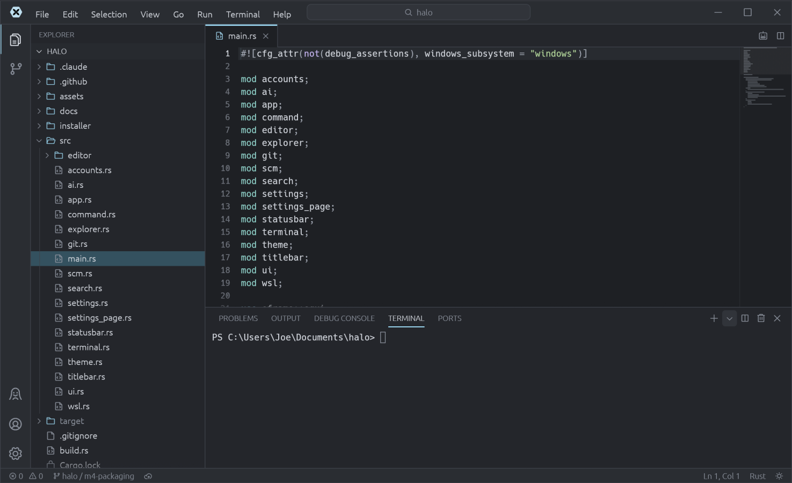
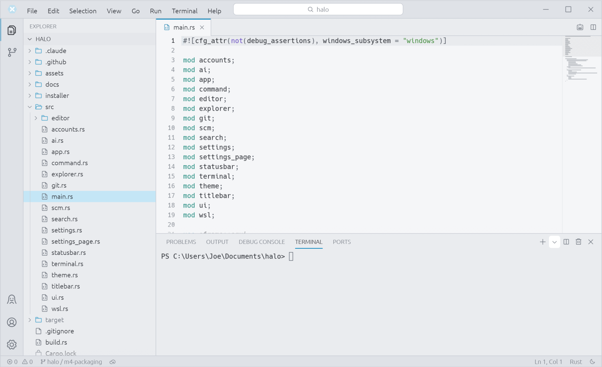

<p align="center"></p>

<h1 align="center">Halo</h1>

<p align="center">
  <a href="https://github.com/joezhuo2/halo/releases/latest"></a>
  <a href="https://github.com/joezhuo2/halo/releases"></a>
  <a href="https://github.com/joezhuo2/halo/actions/workflows/release.yml"></a>
  
  <a href="https://www.rust-lang.org"></a>
  <a href="https://www.egui.rs"></a>
  <a href="LICENSE"></a>
</p>

<p align="center">
  <a href="#download">Download</a> •
  <a href="#features">Features</a> •
  <a href="#settings-and-keybinds">Keybinds</a> •
  <a href="#screenshots">Screenshots</a> •
  <a href="#files">Files</a> •
  <a href="#development">Development</a> •
  <a href="#contributing">Contributing</a> •
  <a href="#license">License</a>
</p>

> Halo is an ultra-lightweight native code editor laid out like VS Code. It is
> written in Rust with egui on OpenGL, with no Electron and no web view, and
> ships as one executable. It has an explorer, a multi-cursor editor with split
> views and language server support, an integrated terminal, source control
> with a commit graph and pull requests, a panel that runs the Claude and
> Codex CLIs, and a settings page for fonts, colors, languages and key
> bindings.

<p align="center"></p>

## Download

Get the latest build from
[Releases](https://github.com/joezhuo2/halo/releases/latest):

- **Windows installer:** `halo-x.y.z-windows-x64-setup.exe`. Installs per
  user, no admin prompt. Adds a Start menu entry and **Open with Halo** on
  files, folders and folder backgrounds.
- **Windows portable:** `halo-x.y.z-windows-x64.exe`. One file, no install.
- **Linux x64:** `halo-x.y.z-linux-x64.tar.gz`.
- **macOS:** `halo-x.y.z-macos-arm64.tar.gz` (Apple silicon) or
  `halo-x.y.z-macos-x64.tar.gz` (Intel).

Windows 11 is the tested platform. The Linux and macOS builds compile and are
produced by the same workflow, but have not been run by hand yet.

### First launch

Halo is not code-signed, so the system warns the first time you open it. The
builds come from the public [release workflow](.github/workflows/release.yml),
so you can check what went into them.

- **Windows:** SmartScreen says "Windows protected your PC". Click
  **More info**, then **Run anyway**. You only see this once.
- **macOS:** the download is quarantined. Unpack it, run this, then start it:

  ```bash
  xattr -d com.apple.quarantine ./halo
  ```

- **Linux:** unpack and run `./halo`. It needs OpenGL and either X11 or
  Wayland.

Halo needs `git` on `PATH` for source control, the `gh`, `claude` and `codex`
CLIs for pull requests and the AI panel, and a language server for each
language you want diagnostics and completion in. Each is optional.

## Features

### Editor

- **Multi-cursor editing:** `Ctrl+D` adds the next occurrence, `Ctrl+Alt+Up`
  and `Ctrl+Alt+Down` add cursors above and below.
- **Selections:** `Alt+Click` adds a cursor, `Shift+Alt+drag` selects a box,
  `Ctrl+Shift+L` selects every occurrence, `Shift+Alt+Right` and
  `Shift+Alt+Left` grow and shrink the selection, and `Ctrl+U` undoes the
  last cursor move.
- **Find and replace** in the file (`Ctrl+F`, `Ctrl+H`) with match case,
  whole word, regular expressions (`$1` in the replacement), find in
  selection and preserve case. **Go to Line** is `Ctrl+G`.
- **Search in files** (`Ctrl+Shift+F`) in the side bar: replace in files,
  include and exclude globs, a results tree, and the results as a tab whose
  lines open on a double-click.
- **Line operations:** move (`Alt+Up`, `Alt+Down`), copy (`Shift+Alt+Up`,
  `Shift+Alt+Down`), delete (`Ctrl+Shift+K`), join, and insert a line above
  (`Ctrl+Shift+Enter`) or below (`Ctrl+Enter`). Comments toggle with `Ctrl+/`
  (line) and `Shift+Alt+A` (block).
- **Brackets and quotes** close as you type and wrap a selection. Brackets
  are colored by depth, with indentation guides.
- **Word wrap** (`Alt+Z`), **code folding** by indentation (the gutter arrows,
  `Ctrl+Shift+[` and `Ctrl+Shift+]`), **sticky scroll**, rulers and visible
  whitespace. Each has a switch in Settings.
- **Snippets** with tab stops from `snippets.json` and from language servers,
  **word completion** in files without a server, and **Emmet**: `Tab` expands
  an abbreviation such as `ul>li*3` in HTML, Vue, Svelte and PHP files.
- **Status bar pickers** for the language, indentation (detect and convert),
  encoding and line ending of the file.
- **Links** in the text open with `Ctrl+Click`.
- **Syntax highlighting** for 68 languages from the bundled grammars, plus
  any `.sublime-syntax` file you add. A minimap sits beside the text.
- **Tabs:** drag a tab to reorder it, drop it on another group to move it, or
  drop it on the left or right third of an editor to open it side by side.
  The tab follows the pointer and the others slide apart to show where it
  lands. Right-click a tab to pin it; pinned tabs stay on the left, are
  skipped by Close Others, Close All and `Ctrl+W`, and come back after a
  restart. A newly opened file is a preview with
  an italic title, and the next file you open takes its tab until you edit it
  or double-click the tab. `Ctrl+Tab` switches between recent files,
  `Ctrl+Shift+T` reopens a closed one, and `Alt+Left` and `Alt+Right` go back
  and forward.
- **Split editor** (`Ctrl+\`) shows one file in several groups.
- **Merge conflicts** get a bar with Accept Current, Accept Incoming, Accept
  Both and Next, and open in the **merge editor**: Incoming, Current, an
  optional Base and an editable Result, with accept per conflict and Complete
  Merge, which saves and stages the file.
- **Diff editor:** changes open side by side, and the working tree side is
  the live file, so you can edit it there. `Alt+F5` and `Shift+Alt+F5` step
  through changes. Stage, unstage or revert a single hunk or the selected
  lines. Click a change mark in the gutter to peek at the change.
- **Compare** the active file with another file, the clipboard or its saved
  version.
- **Markdown preview** (`Ctrl+Shift+V`, or `Ctrl+K V` to the side) follows
  the source as you type and scroll.
- **Images** (png, jpg, gif, webp, bmp, ico, svg) open in a viewer with zoom
  and pan. Binary files show a notice instead of text, and files over 20 MB
  open in a light mode without highlighting or language servers.
- **Auto save** (off by default): after a delay, on focus change or on window
  change. Saving can trim trailing whitespace and add a final newline.
- **Hot exit:** unsaved and untitled files come back the next time Halo
  opens. When a file you changed also changes on disk, a bar offers Compare,
  Use Disk Version and Overwrite.
- **Auto update** (on by default): when Halo opens it looks for a newer
  release, checks its SHA-256, installs it in the background and uses it the
  next time Halo opens. It needs `curl` on `PATH`.

### Language servers

Halo starts the language server of a file when you open it, if that server is
on `PATH`. Nothing is bundled and nothing is downloaded. The defaults cover
`rust-analyzer`, `pyright-langserver`, `typescript-language-server`, `gopls`,
`clangd`, `csharp-ls`, `jdtls`, `lua-language-server`, `zls` and the VS Code
JSON, HTML and CSS servers; **Settings > Languages** sets the command for each
file extension.

- **Diagnostics:** errors and warnings are underlined in the text and marked
  in the minimap, listed in the **Problems** panel (`Ctrl+Shift+M`) and
  counted in the status bar. Click a problem to go to it.
- **Completion** as you type or with `Ctrl+Space`, **signature help** inside
  a call, and **hover** when the pointer rests on a name.
- **Go to Definition** (`F12` or `Ctrl+Click`), declaration, type definition
  and implementations, **Peek Definition** (`Alt+F12`) and **Find All
  References** (`Shift+F12`). Several results open a peek list with a preview
  of each place. `Alt+Left` goes back.
- **Reference counts** sit on a line above each function, method and type.
  Click one to peek at the places that use it. Interfaces and traits also
  show their implementations.
- **Rename Symbol** (`F2`) across files, **Quick Fix** and refactorings
  (`Ctrl+.`), and **Organize Imports** (`Shift+Alt+O`).
- **Format Document** (`Shift+Alt+F`) and **Format Selection**
  (`Ctrl+K Ctrl+F`), with optional format on save and on paste.
- **Symbols:** `Ctrl+T` searches the workspace, the **Outline** section under
  the explorer lists the active file, and the breadcrumbs above the text show
  the path and the enclosing symbols.
- **Timeline:** the section under the outline lists the commits that changed
  the active file and the versions kept each time you saved it (**local
  history**). Click one to open its diff; a saved version can be restored.
- **Semantic highlighting**, **inlay hints** for inferred types and parameter
  names, and **call** (`Shift+Alt+H`) and **type hierarchy** in the peek list.
- Server messages go to the **Output** panel, and the status bar shows what
  the servers are doing. **Restart Language Servers** is in the command list.

Each of these can be switched off under **Settings > Text Editor**.

### Explorer

- Files and folders are colored by git state: green for new, yellow for
  modified, red for deleted, gray for ignored.
- New file, new folder, rename, delete to the Recycle Bin, copy path and
  reveal in the file manager, from the right-click menu.
- Select several files (`Ctrl+Click`, `Shift+Click`), cut, copy and paste
  them, drag them to another folder, and drop files in from the operating
  system.
- **Open Editors** lists the open tabs above the tree. Type, or press
  `Ctrl+Alt+F`, to filter the tree. `files_exclude` hides files, and folder
  chains with a single child are shown on one row.

### Source control

- Stage, unstage and discard changes, write a message and commit with
  `Ctrl+Enter`. Amend, or undo the last commit.
- Switch or create branches, push, pull, fetch, and synchronize from the
  status bar. Merge, rebase and cherry-pick, with Continue, Abort and Skip
  while one is in progress.
- Tags, remotes, worktrees, Clone and Initialize Repository, and a Stashes
  section with Show, Apply, Pop and Drop.
- **Blame** for the current line in the status bar, and inline on the caret
  line if you turn it on.
- The changes, pull requests and commits sections can be minimized, and
  resized by dragging the line between them.
- **Commit graph** with lanes and branch labels. Click a commit to list its
  files, and a file to open its diff.
- **Pull requests** through the `gh` CLI: list, create, check out, approve,
  request changes and comment.
- **Accounts:** list and switch the GitHub accounts `gh` is signed in to.
- Repositories nested inside the open folder are listed and can be selected.

### Terminal

- Runs PowerShell, Command Prompt, Git Bash, WSL or any shell you add as a
  profile.
- Several terminals, each of which can be split side by side. Every pane has
  its own row in the list, and the focused one is highlighted.
- `Ctrl+Click` opens a URL or a file path, at the line and column when the
  output names them. `Ctrl+F` finds in the terminal.
- **Shell integration** for PowerShell, bash and zsh marks each command with
  its exit status; `Ctrl+Up` and `Ctrl+Down` move between commands.
- Rename a terminal, give it a colour, or move it into the editor area.
- **Ports** lists listening ports with their process. **Output**
  (`Ctrl+Shift+U`) has a channel each for Git, language servers, debugging,
  tasks and Halo itself.

### AI panel

- `Ctrl+Alt+B`, or the robot button beside Split Editor, opens a panel with a
  **Claude** tab and a **Codex** tab. Each runs that CLI in the open folder
  when you press **Start session**. Nothing starts until you ask.

### Search

The bar in the title bar (`Ctrl+P`) finds files by name. A prefix changes
what it searches:

| Prefix | Searches |
| --- | --- |
| none | Files in the open folder |
| `>` | Commands |
| `%` | Text in files |
| `@` | Symbols in the current file |
| `#` | Symbols in the workspace, from the language servers |
| `:` | A line number |

### Run, debug and test

- `F5` saves the file and runs it with the command set for its extension.
  With a `.vscode/launch.json` in the folder, `F5` starts the debugger
  instead and `Ctrl+F5` runs without it.
- **Debugger** for any Debug Adapter Protocol adapter on `PATH` (defaults for
  codelldb, lldb-dap, gdb, debugpy and dlv; set others in `debug_adapters`):
  breakpoints with conditions, hit counts and logpoints (`F9`), stepping
  (`F10`, `F11`, `Shift+F11`), variables, watch, call stack, and a Debug
  Console that evaluates expressions while paused.
- **Tasks** from `.vscode/tasks.json`, plus npm, yarn, pnpm, bun and cargo
  tasks found in the folder. `Ctrl+Shift+B` runs the build task. Problem
  matchers send compiler errors to the Problems panel.
- **Testing** view for cargo, pytest, go, Jest and Vitest: run all, run
  failed, run or debug the test at the cursor, and run with coverage.

### WSL

- **Switch to WSL** in the activity bar reopens the folder in a WSL distro.
  Terminals, Run and the AI panel then run inside it.

### Settings and keybinds

`Ctrl+,` opens Settings, with categories on the left:

| Category | What it sets |
| --- | --- |
| Text Editor | Font family, font size, tab size, spaces or tabs, minimap, breadcrumbs, code lens, inlay hints, semantic highlighting, format on save and paste, diagnostics and the status bar counts |
| Files | Auto save |
| Appearance | Dark or light theme, and every interface and syntax color for each theme |
| Terminal | Default profile and the list of profiles |
| Run and Tasks | The run command for each file extension, and named tasks |
| Languages | Grammars folder, file associations, language servers and their commands, and the installed languages |
| Keyboard Shortcuts | Every command with its key, grouped by category |

A search box at the top filters the settings; `@modified` lists the ones you
changed. Settings can also live in the folder's `.vscode/settings.json`
(the Workspace tab) and in `"[language]"` blocks, and both files accept VS
Code's setting names. VS Code color themes and file icon themes can be
imported from a file or from installed VS Code extensions.

To change a key, click it in **Keyboard Shortcuts** and press the new one or
a two-step chord; the page lists the commands already on those keys. Each
binding can have a `when` clause, as in VS Code's `keybindings.json`.

The defaults follow VS Code:

| Key | Action |
| --- | --- |
| `Ctrl+P` | Go to file |
| `Ctrl+Shift+P` | Show all commands |
| `Ctrl+Shift+F` | Find in files |
| `Ctrl+Shift+O` | Go to symbol |
| `Ctrl+T` | Go to symbol in workspace |
| `F12` | Go to definition |
| `Shift+F12` | Find all references |
| `F2` | Rename symbol |
| `Ctrl+.` | Quick fix |
| `Shift+Alt+F` | Format document |
| `Ctrl+Space` | Trigger suggest |
| `Ctrl+Shift+M` | Problems |
| `Ctrl+B` | Toggle side bar |
| `Ctrl+J` | Toggle panel |
| `Ctrl+Alt+B` | Toggle AI panel |
| `Ctrl+\` | Split editor |
| `` Ctrl+Shift+` `` | New terminal |
| `Ctrl+K Ctrl+O` | Open folder |
| `Ctrl+K Ctrl+T` | Switch light and dark theme |
| `F5` | Run file |

The sun or moon at the right end of the status bar also switches the theme.

### Limits

- Language features need a server that is installed and on `PATH`, and they
  are off in WSL folders.
- The peek list and the popups sit over the text instead of pushing it down.
- Completions insert plain text, without snippet tab stops. Server code
  lenses such as Run and Debug, and the quick fix lightbulb, are not shown.
- Call and type hierarchy list one level at a time.
- New grammars and file associations load when Halo starts.
- Debugging and testing need the adapter or test tool on `PATH`; one debug
  session runs at a time.
- Imported icon themes must use SVG or PNG icons, and imported color themes
  must be JSON.
- No font ligatures or letter spacing, and no VS Code extensions.

## Screenshots

Click an image to view it at full size.

| | |
| :---: | :---: |
| [](assets/screenshot-editor.png)<br>**Editor** with the explorer and an integrated terminal. | [](assets/screenshot-source-control.png)<br>**Source control** with pull requests and the commit graph. |
| [](assets/screenshot-settings.png)<br>**Settings** lets you change every color of a theme. | [](assets/screenshot-light.png)<br>**Light theme**, one click from the status bar. |

## Files

| What | Windows | Linux | macOS |
| --- | --- | --- | --- |
| Settings | `%APPDATA%\halo\settings.json` | `~/.config/halo/` | `~/Library/Application Support/halo/` |
| Key bindings | `%APPDATA%\halo\keybindings.json` | `~/.config/halo/` | `~/Library/Application Support/halo/` |
| Open folder, files and panels | `%APPDATA%\halo\session.json` | `~/.config/halo/` | `~/Library/Application Support/halo/` |
| Extra grammars | `%APPDATA%\halo\grammars\` | `~/.config/halo/grammars/` | `~/Library/Application Support/halo/grammars/` |

Everything on the Settings page is stored in `settings.json`, and the button
at the top right of the page opens the file. Saving it in Halo applies it.
Each entry in `keybindings.json` is
`{"key": "ctrl+k ctrl+o", "command": "openFolder"}`; it replaces the default
keys of that command, and an empty `key` removes them.

## Development

### Build

Requirements: Rust 1.85 or newer, and `git` on `PATH`.

```bash
cargo run --release
```

To build the Windows installer locally, install Inno Setup 6.3 or newer and
run this after `cargo build --release`. The result lands in `dist`.

```bash
ISCC /DAppVersion=x.y.z installer\halo.iss
```

### Releasing

Releases are built by GitHub Actions. Set `version` in `Cargo.toml`, add a
`## [x.y.z] - date` section to `CHANGELOG.md` listing the changes, commit,
then push a tag `vx.y.z`. [release.yml](.github/workflows/release.yml) builds
every platform and creates a draft GitHub release with the files attached and
that changelog section as its notes. Review the draft and publish it. The run
fails if the tag does not match the `Cargo.toml` version or `CHANGELOG.md` has
no section for it.

### Tests

```bash
cargo test
```

35 tests: the edit engine, highlighting, git parsing against a real temporary
repository, explorer logic on a temporary folder, tab moves and pins, key
bindings, terminal key encoding and colors, a real shell round trip through
the PTY, theme colors, the logo, language server messages and result parsing,
and headless editor tests that type and click through egui input, including
through code lens rows and inlay hints. `cargo test -- --ignored` adds a round
trip with a real `rust-analyzer`.

### Layout

```
src/
  main.rs           window setup and test mode
  app.rs            the Halo app: panels, command dispatch, dialogs, auto save
  command.rs        commands, default keys and keybindings.json
  titlebar.rs       menus, search box and window buttons
  statusbar.rs      problems, branch, sync, position and theme switch
  explorer.rs       file tree with git colors and file operations
  editor/           buffer and edits, highlighting, tabs, groups, the view and
                    the language features drawn in it
  lsp.rs            language server processes, messages and result parsing
  search.rs         file, command, text, symbol and line search
  git.rs            git and gh calls, status, log and graph lanes
  scm.rs            source control side bar
  accounts.rs       GitHub accounts menu
  terminal.rs       terminal emulator, bottom panel and ports
  ai.rs             Claude and Codex CLI panel
  wsl.rs            WSL distros and path mapping
  settings.rs       settings.json and session.json
  settings_page.rs  the Settings page
  theme.rs          dark and light themes, custom colors and fonts
  ui.rs             shared widgets, animation helpers and the logo
installer/halo.iss  Inno Setup script
assets/             icon, screenshots and the demo
docs/               requirements, decisions, architecture, milestones, handoff
```

### Memory (Windows 11, release build)

Measured on the milestone 3 build, maximized on a high-DPI display.

| State | Private working set |
| --- | --- |
| Folder open | about 90 MB |
| Folder, a file and a terminal | about 100 MB |

## Contributing

Bug reports and pull requests are welcome. [CONTRIBUTING.md](CONTRIBUTING.md)
says how to build, test and send a change, and the
[Code of Conduct](CODE_OF_CONDUCT.md) applies to everyone taking part. Report
security problems through [SECURITY.md](SECURITY.md).

## License

MIT.
